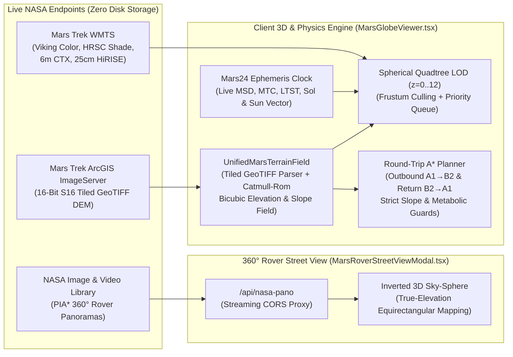

# ARES-NAVIGATOR — 3D Mars Expedition Command, Terrain Hazard Analyzer & Round-Trip Route Planner

**ARES-NAVIGATOR** is a real-time 3D planetary GIS and tactical traverse planning application for Mars surface exploration, built with **Next.js (App Router)**, **React 19**, **Three.js**, and **Tailwind CSS**.

It streams live orbital imagery, 16-bit digital elevation models (DEMs), and 360° surface rover panoramas directly from **NASA Solar System Treks (Mars Trek)** and the **NASA Image & Video Library** on the fly—requiring **zero static terrain or imagery files stored on disk**.

---

## Key Features

### 1. Multi-Resolution Quadtree 3D Mars Globe (LOD `z=0` to `z=12`)
- **View-Frustum & Horizon Culling**: Dynamically subdivides and lazy-loads spherical quadtree tiles (`QuadTileNode`) only for the surface region actively watched by the camera, bounded by a priority download scheduler (`MAX_CONCURRENT_DOWNLOADS = 6`).
- **Selective Ultra-HD Expedition Hubs**:
  - Global Martian surface renders up to `z=5` for lightweight planetary navigation.
  - Four key **Expedition Hubs** unlock deep `z=12` quadtree subdivision combining **25 cm/px HiRISE**, **6 m/px MRO CTX**, **HRSC Hillshade**, and **Viking MDIM 2.1 Color Mosaics**:
    1. **Jezero Crater Delta Front** ($18.4447^\circ\text{N}, 77.4508^\circ\text{E}$) — *Primary Mars 2020 Perseverance Landing Site*
    2. **Mount Sharp / Gale Crater** ($4.72^\circ\text{S}, 137.48^\circ\text{E}$) — *Aeolis Mons 5.5 km Sedimentary Peak & MSL Curiosity Hub*
    3. **Arcadia Planitia** ($46.45^\circ\text{N}, 170.8^\circ\text{W}$) — *Candidate Human ISRU Ice-Sheet Basecamp*
    4. **Melas Chasma / Valles Marineris** ($9.85^\circ\text{S}, 72.6^\circ\text{W}$) — *9 km Deep Tectonic Canyon System*

### 2. Seamless $C^1$-Continuous Bicubic Terrain & Dynamic Slope Radar
- **Unified Terrain Field (`UnifiedMarsTerrainField`)**:
  - Decodes tiled 16-bit signed integer (`S16`) GeoTIFF DEMs (`Tag 322 TileWidth`, `Tag 323 TileLength`, `Tag 324 TileOffsets`) from NASA Trek's `Mars_MOLA_blend200ppx_HRSC_DEM_clon0dd_200mpp_lzw` ImageServer and blends them with the global MOLA DEM across a cosine-feathered ROI margin.
  - Evaluates elevation $z(\phi, \lambda)$ and central-difference surface gradients $(\partial z/\partial x, \partial z/\partial y)$ via **Catmull-Rom Bicubic Interpolation** in continuous `(lat, lon)` world coordinates at true `1.00x` physical scale, eliminating tile-border cracks and slope seam artifacts.
- **Dynamic Anti-Rollover Slope Radar & Tactical Contours**:
  - **`SLOPE RADAR`**: Real-time pixel shader/canvas overlay classifying surface grade into `< 8°` (Nominal Green), `8°–15°` (Caution Amber), and `> 15°` (Critical Rollover Hazard Red).
  - **`CONTOURS`**: Continuous 60-meter elevation isolines across all LOD levels.

### 3. Strict Round-Trip (`A1 → B2` & `B2 → A1`) A* Surface Route Planner
- **Two Specialized Traverse Physics Engines**:
  - **`[ROVER AUTOPILOT]` (6-Wheel Rocker-Bogie)**:
    - **Hard Constraint**: Any cell with slope $\theta > 15.0^\circ$ or lateral roll $> 11.5^\circ$ is strictly impassable (`Infinity` cost) to prevent rover rollover or high-centering.
    - Optimizes wheel traction ($\mu$), slip risk, and Wh/km drivetrain power consumption while penalizing negative-TPI depression sand traps.
  - **`[ASTRONAUT HIKE]` (Pressurized xEMU Suit EVA)**:
    - **Asymmetric Hard Constraints**: Enforces uphill grade $\le +20.0^\circ$, downhill grade $\ge -14.0^\circ$ (to prevent forward center-of-mass tumble in a pressurized suit), and a 1-cell safety setback around $> 25.0^\circ$ cliffs.
    - Minimizes cumulative bio-metabolic energy expenditure (Pandolf–Santee Martian $0.38g$ equation) and suit LCVG cooling water burn.
- **True Outbound + Return Dual Paths**:
  - Computes **both** the **Outbound Traverse (`A1 → B2`, Cyan)** and the **Safe Return / Walkback Leg (`B2 → A1`, Amber)**.
  - Because uphill climbs on the outbound leg invert into downhill descents on the return leg (e.g., a $+16^\circ$ uphill climb becomes a forbidden $-16^\circ$ downhill descent on return), both directions are independently solved and verified.
- **Untraversable Route Detection & Safe Haven Scanner**:
  - Never routes through forbidden terrain. If either the outbound or return leg is blocked by $>15^\circ$ walls or cliffs, the planner aborts and displays **`⛔ ROUTE UNTRAVERSABLE — MISSION ABORTED`** with the exact physical cause and a **`SCAN NEARBY SAFE HAVEN`** button that locates the nearest reachable safe target.
- **Clean Inspection UX**:
  - **`✕ EXIT ROUTE`** button in the Top Bar and Left Sidebar hides all routes and pins for clean planetary exploration.
  - **Cursor-Proximity Auto-Hide**: Floating map badges, waypoints, and HUD cards automatically fade when the mouse cursor approaches them while inspecting a route.

### 4. Real-Time Mars Astronomical Ephemeris & Sol Sync
- Implements the **NASA GISS Mars24 Astronomical Algorithm** (`computeRealMarsTimeAndSun`):
  - Computes live **Mars Sol Date (`MSD`)**, **Coordinated Mars Time (`MTC`)**, and **Local True Solar Time (`LTST`)** at the watched longitude directly from `Date.now()`.
  - Tracks accurate live mission sols: **Perseverance Sol** (landed Feb 18, 2021, `MSD 52303.99`) and **Curiosity Sol** (landed Aug 6, 2012, `MSD 49268.90`).
  - Calculates real-time **subsolar latitude & longitude** on Mars, syncing the 3D directional Sun light and **Nightfall Freeze Countdown (`❄ FREEZE IN ...`)** to current Martian daylight conditions.

### 5. Interactive 360° Rover Street View (`360° OPTICS`)
- Puts subtle geometric vector optic markers (`CAM-01` through `CAM-10`) at the exact `(lat, lon, elevation)` coordinates where **Perseverance** (Jezero Crater) and **Curiosity** (Mount Sharp / Gale Crater) captured stitched 360° Mastcam-Z, Mastcam, and Navcam panoramas.
- Clicking any optic marker opens an interactive **WebGL Three.js 360° Equirectangular Sphere Viewer**:
  - Maps the NASA Photojournal (`PIA*`) panorama to its true vertical elevation band (`elMinDeg` to `elMaxDeg`) so rocks, delta strata, and rover deck hardware retain 1:1 physical proportions.
  - Progressive texture streaming via `/api/nasa-pano` upgrades seamlessly from fast preview (`~large` / `~medium`) to full archival resolution (`~orig`).
  - Supports click-and-drag $360^\circ$ look-around, scroll-wheel optical zoom (`1.0x`–`3.0x`), live compass heading & pitch readout, **`360° AUTO-SCAN`**, and **`◀ PREV CAM` / `NEXT CAM ▶`** station stepping.

---

## Working Principle & Architecture



### Core Mathematical Pipelines
1. **Tiled 16-Bit GeoTIFF Unpacking & Catmull-Rom Bicubic Surface**:
   - ArcGIS ImageServer exports `256×256` `S16` GeoTIFFs partitioned into internal `128×128` TIFF tiles (`Tag 322/323/324`). `UnifiedMarsTerrainField.decodeGeoTiffS16` parses the IFD directory, reconstructs the row-major elevation matrix in meters, and evaluates 16-point $4\times 4$ bicubic Hermite splines so both $z(\phi,\lambda)$ and surface normals $\mathbf{n}(\phi,\lambda)$ are continuous across all quadtree LOD boundaries.
2. **Metric Central-Difference Slope & Rover Chassis Attitude**:
   - At any coordinate $(\phi, \lambda)$ and rover heading $\psi$, East and North metric gradients are evaluated over a uniform baseline:
     $$\frac{\partial z}{\partial x} = \frac{z(\phi, \lambda + \Delta\lambda) - z(\phi, \lambda - \Delta\lambda)}{2\Delta s}, \quad \frac{\partial z}{\partial y} = \frac{z(\phi + \Delta\phi, \lambda) - z(\phi - \Delta\phi, \lambda)}{2\Delta s}$$
   - Total slope $\theta = \arctan\sqrt{(\partial z/\partial x)^2 + (\partial z/\partial y)^2}$, longitudinal pitch, and lateral roll drive the live **Gyro-Inclinometer**, **6-Wheel Torque bars**, and **A* admissibility checks**.

---

## Project Structure

- [`app/MarsGlobeViewer.tsx`](file:///home/bigt/experiments/spaceapps/app/MarsGlobeViewer.tsx) — Core 3D quadtree globe, `UnifiedMarsTerrainField` GeoTIFF decoder & bicubic sampler, `computeRealMarsTimeAndSun` ephemeris clock, `computeRoundTripSafeRoute` A* planner, and tactical cockpit UI.
- [`app/MarsRoverStreetViewModal.tsx`](file:///home/bigt/experiments/spaceapps/app/MarsRoverStreetViewModal.tsx) — Interactive Three.js 360° Rover Street View modal, `TacticalOpticIcon` vector reticle, and metadata for the 10 Perseverance & Curiosity panorama stations.
- [`app/api/nasa-pano/route.ts`](file:///home/bigt/experiments/spaceapps/app/api/nasa-pano/route.ts) — Zero-storage streaming Route Handler that proxies official `images-assets.nasa.gov` `PIA*` panoramas with WebGL CORS headers.
- [`docs/mars-route-planning-constraints.pdf`](file:///home/bigt/experiments/spaceapps/docs/mars-route-planning-constraints.pdf) — Engineering specification detailing the physical constraints and NASA Trek derivation formulas for Rover and Astronaut EVA routing.

---

## Getting Started

### Prerequisites
- **Node.js** `>= 18.18.0`
- Active internet connection (to stream live tiles, 16-bit DEMs, and 360° panoramas from NASA servers)

### Installation & Development Server

```bash
# Install dependencies
npm install

# Start the Next.js development server on http://localhost:3000
npm run dev
```

Open [http://localhost:3000](http://localhost:3000) in your browser.

### Controls Quick Reference
- **Left-Click + Drag**: Pan across the Martian surface
- **Right-Click + Drag** (or `Shift` + Left-Drag): Orbit / rotate camera heading & tilt (`12°` to `78°`)
- **Scroll Wheel**: Zoom from planetary orbit (`z=0`) down to `25 cm/px` surface detail (`z=12`)
- **Double-Click Surface**: Smoothly center camera on clicked coordinates
- **`PICK ON MAP` (`START A1` / `DEST B2`)**: Click any point on the 3D terrain to recompute the round-trip route (`A1 → B2` and `B2 → A1`)
- **`CAM-01`–`CAM-10` Optic Pins**: Click any subtle optic marker on the surface (or in the Left Sidebar) to enter **360° Rover Street View**
